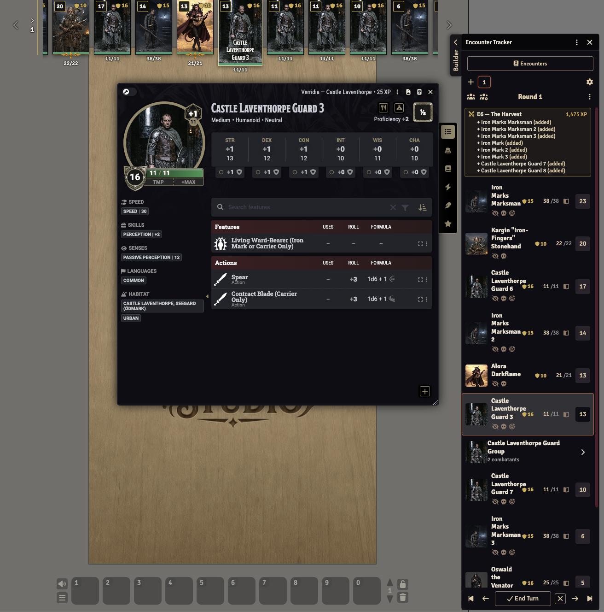

# Encounter Deck

**Prep your fights by campaign. Run them as real combat. Keep the map clean for your minis.**

Encounter Deck is a Foundry VTT module for D&D 5e GMs. You build encounters ahead of time, organised by campaign, and nothing touches a scene until you start the fight. When you do, the monsters join a real Foundry combat with their tokens parked in the scene's margin, off the map. That way the table display stays clear for miniatures, and you still get initiative, HP, conditions and stat blocks. A carousel across the top of the screen shows the whole table whose turn it is.

Needs **Foundry VTT v14** and **dnd5e 5.3 or later**. Current version: **v0.10** ([changelog](CHANGELOG.md)).

## Screenshots

From a real campaign, so you can see what it looks like at the table.

| The Builder and the encounter browser | A fight: Carousel, tracker and Stat Block |
| :---: | :---: |
|  |  |

## What it does

### Prep

- **Campaigns.** Several campaigns in one world, each with its own folders of encounters and its own party (an Actors folder). Mark who's at the table tonight, and pick XP or Milestone per campaign.
- **The Builder.** A drawer beside the Combat tab. Search your monster compendiums, filter by CR, type, size, habitat and source book, and add monsters with a click or a drag. A live 2024 difficulty meter shows how hard it is for tonight's party.
- **Encounters.** Each one has its monsters, notes, tactics, tags, a link to a journal page or scene, a status (Draft, Ready, Completed), and an "in its lair" switch for legendary monsters.
- **Shared Library.** Reusable encounters for every campaign. Using one makes a copy in the campaign, so the original stays untouched.
- **Sources.** Pick which compendiums the Builder searches. Every monster shows where it comes from, such as "SRD 5.2 · 2024" or "Monster Manual 2024".

### Running the fight

- **Import.** Press ▶ on an encounter. Its monsters get numbered tokens in the margin right beside the map, and they join the combat with the PCs who are present. Import another encounter mid-fight for reinforcements.
- **Add on the fly.** Drop a monster, a PC or a whole encounter onto the tracker during a fight. New monsters roll initiative straight away and slot into the turn order.
- **A better tracker.** AC and HP on every row. Type `-7` for damage or `+5` for healing. A row at the top shows the fight's encounter and the XP it's worth.
- **Stat Blocks.** A monster's sheet opens in one fixed spot beside the sidebar. When the turn passes to a monster, its sheet comes up.
- **Legendary monsters.** Gold pips show legendary actions and resistances left. Hover them for a small menu that uses an action in one click, and shows which recharge abilities are ready.

### At the table

- **The Carousel.** The fight in initiative order across the top of the screen, for everyone (or only the GM, if you prefer). Players see the heroes' initiative and HP. For monsters they only see when one is Bloodied.
- **The table display stays on the map.** If you use Monk's Common Display, it won't pan off the map to follow monsters in the margin.

### When the fight ends

- **Finish.** End the combat as usual. The encounter is marked Completed and moves to the campaign's Completed folder. In XP mode, its XP is split between the PCs who were there. Every imported token and actor is cleaned up.
- **Loot.** With Monk's TokenBar, the loot dialog hands out the monsters' gear and coins to the PCs, or into the party inventory if you use Mobile Deck.

## Works with

- **Monk's Common Display**: the Carousel can show on the table display, which stays on the map during monster turns.
- **Monk's TokenBar**: its loot dialog becomes Distribute Loot. Encounter Deck offers to turn off TokenBar's own XP dialog, so XP isn't awarded twice.
- **[Mobile Deck](https://github.com/EdenMichal/mobile-deck)**: loot can go straight into the party inventory.
- **Carousel Combat Tracker**: Encounter Deck has its own carousel, so it offers to turn that one off.

## More modules

- **[Music Deck](https://github.com/EdenMichal/music-deck)**: two music decks with a crossfader, ambient sound scenes, SFX pads and combat music, played from a redesigned Playlists tab or an Elgato Stream Deck+.
- **[Mobile Deck](https://github.com/EdenMichal/mobile-deck)**: a phone and tablet interface for Foundry (D&D5e and PF2e), with a Character Builder and party inventory.

## Install

There's no packaged release yet, so install from source:

```bash
npm install
npm run build
```

Then link the `module/` folder into your Foundry data folder's `modules/` directory. Set `FOUNDRY_DATA` to your Foundry user data path (the folder that holds `Data/`):

```bash
ln -s "$PWD/module" "$FOUNDRY_DATA/Data/modules/encounter-deck"
```

Foundry only notices a new module when a world is launched from Setup, so relaunch the world once, then enable Encounter Deck in Manage Modules.

## Develop

```bash
npm run watch      # rebuild module/dist/main.js on change
npm test           # vitest
npm run typecheck
```

The design lives in [PLAN.md](PLAN.md), the terms in [CONTEXT.md](CONTEXT.md), and the decisions in [docs/adr/](docs/adr/).
