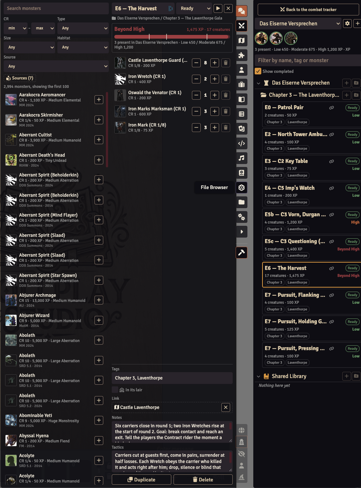

# Encounter Deck

**Encounter prep for D&D 5e GMs who play with miniatures on a Foundry table display.**

I built Encounter Deck for my own table. The map goes on a table display and the monsters are miniatures, so monster tokens on the map only get in the way, but I still wanted Foundry to track initiative, HP and conditions. So you build encounters ahead of time, sorted by campaign, and none of it touches a scene until the fight starts. Then the monsters join a real Foundry combat with their tokens parked in the scene's margin, off the map. A carousel across the top of the screen shows everyone whose turn it is.

It needs Foundry VTT v14 and dnd5e 5.3 or later. To install it, paste this manifest URL into Foundry's **Add-on Modules › Install Module** ([details below](#install)):

```text
https://github.com/EdenMichal/encounter-deck/releases/latest/download/module.json
```

This is v1.0, and the [changelog](CHANGELOG.md) lists what each version added.

## Screenshots

From a real campaign, so you can see what it looks like at the table.

| The Builder and the encounter browser | A fight: Carousel, tracker and Stat Block |
| :---: | :---: |
|  |  |

## What it does

### Prep

- **Campaigns.** Several campaigns in one world, each with its own folders of encounters and its own party (an Actors folder). Mark who's at the table tonight, and pick XP or Milestone per campaign.
- **The Builder.** A drawer beside the Combat tab. Search your monster compendiums, filter by CR, type, size, habitat and source book, and add monsters with a click or a drag. A live 2024 difficulty meter shows how hard it is for tonight's party.
- **Encounters.** Each one has its monsters, notes, tactics, tags, a link to a journal page or scene, a status (Draft, Ready, Completed), and an "in its lair" switch for legendary monsters.
- **Shared Library.** Reusable encounters for every campaign. Using one makes a copy in the campaign, so the original stays untouched.
- **Sources.** Pick which compendiums the Builder searches. Every monster shows where it comes from, such as "SRD 5.2 · 2024" or "Monster Manual 2024".

### Running the fight

- **Import.** Press ▶ on an encounter. Its monsters get numbered tokens in the margin right beside the map, and they join the combat with the PCs who are present. Import another encounter mid-fight for reinforcements.
- **Add on the fly.** Drop a monster, a PC or a whole encounter onto the tracker during a fight. New monsters roll initiative straight away and slot into the turn order.
- **The tracker.** AC and HP on every row. Type `-7` for damage or `+5` for healing. A row at the top shows the fight's encounter and the XP it's worth.
- **Stat Blocks.** A monster's sheet opens in one fixed spot beside the sidebar. When the turn passes to a monster, its sheet comes up.
- **Legendary monsters.** Gold pips show legendary actions and resistances left. Hover them to open a small menu. One click there uses a legendary action, and it shows which recharge abilities are ready.

### At the table

- **The Carousel.** The fight in initiative order across the top of the screen, for everyone (or only the GM, if you prefer). Players see the heroes' initiative and HP. For monsters, they only see when one is Bloodied.
- **The table display stays on the map.** If you use Monk's Common Display, it won't pan off the map to follow monsters in the margin.

### When the fight ends

- **Finish.** End the combat as usual. Encounter Deck marks the encounter Completed and moves it to the campaign's Completed folder. In XP mode, the PCs who were there split its XP. Then it deletes every token and actor it imported.
- **Loot.** With Monk's TokenBar, the loot dialog hands out the monsters' gear and coins to the PCs, or into the party inventory if you use Mobile Deck.

## Bring your own monsters

Encounter Deck ships no monsters, stat blocks, art or encounters. It works with the monster compendiums already in your world, and everything you build stays in that world.

- **Monsters come from your compendiums.** The Builder searches the compendiums you switch on as Sources. dnd5e's free SRD monsters are there from the start. Anything else you have shows up too, such as books bought on Foundry, monsters brought in with DDB Importer, or your own homebrew compendiums. The Sources list is dnd5e's own source checklist, so it matches dnd5e's Compendium Browser.
- **Encounters link to monsters.** An encounter saves a link to each monster, plus its name, CR and XP. If you later switch off or remove that compendium, the encounter still shows the monster's name and CR, marks the row missing, and lets you swap in a replacement.
- **Fights use temporary copies.** When you import an encounter, Encounter Deck copies its compendium monsters into a hidden Actors folder for the fight, and Finish deletes them again. Your compendiums never change.
- **Your encounters stay in your world.** The first time a GM loads a world, Encounter Deck creates an Encounter Deck compendium there, and your campaigns and encounters go into it. The module uploads nothing, and a new world starts with an empty deck.

## Works with

- **Monk's Common Display.** The Carousel can show on the table display, and the display stays on the map during monster turns.
- **Monk's TokenBar.** Its loot dialog becomes Distribute Loot. Encounter Deck offers to turn off TokenBar's own XP dialog, so the party doesn't get XP twice.
- **[Mobile Deck](https://github.com/EdenMichal/mobile-deck).** Loot goes straight into the party inventory.

## More modules

- **[Music Deck](https://github.com/EdenMichal/music-deck).** Two music decks with a crossfader, ambient sound scenes, SFX pads and combat music, played from a redesigned Playlists tab or an Elgato Stream Deck+.
- **[Mobile Deck](https://github.com/EdenMichal/mobile-deck).** A phone and tablet interface for Foundry (D&D5e and PF2e), with a Character Builder and party inventory.

## Install

1. In Foundry's setup screen, open **Add-on Modules**, click **Install Module**, and paste the manifest URL into the box at the bottom:
   ```text
   https://github.com/EdenMichal/encounter-deck/releases/latest/download/module.json
   ```
2. Launch your world, then tick **Encounter Deck** in **Game Settings › Manage Modules**.
3. Open the world as GM. Encounter Deck creates its compendium the first time, and the encounter browser takes over the Combat tab while no fight is running.

Foundry's **Check for Updates** finds new versions through the same URL.

## Develop

```bash
npm install
npm run build      # module/dist/main.js
npm run watch      # rebuild on change
npm test           # vitest
npm run typecheck
```

To run it from a checkout, link `module/` into your Foundry data folder instead of installing it. Set `FOUNDRY_DATA` to your Foundry user data path (the folder that holds `Data/`):

```bash
ln -s "$PWD/module" "$FOUNDRY_DATA/Data/modules/encounter-deck"
```

To release, bump `version` and the `download` URL in `module/module.json`, then push a tag such as `v1.0.1`. The Release workflow builds the zip and publishes it with `module.json` as a GitHub release.

[PLAN.md](PLAN.md) has the design, [CONTEXT.md](CONTEXT.md) the terms, and [docs/adr/](docs/adr/) the decisions.

## License

[MIT](LICENSE).
